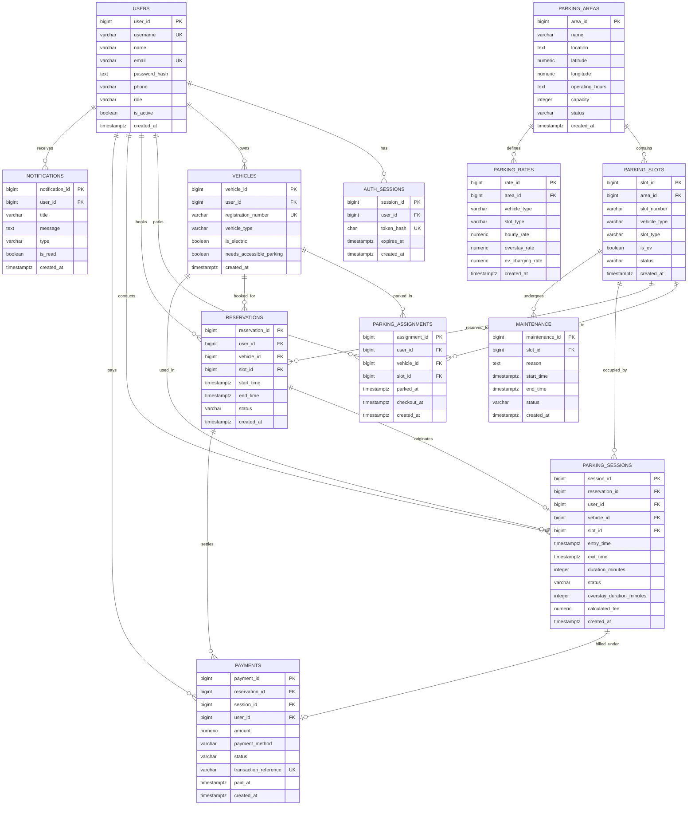

# Database Documentation

## Overview

`database/schema.sql` defines the PostgreSQL database for the project. It
creates the `pgcrypto` extension, 12 core tables, foreign keys, constraints,
and explicit indexes inside a transaction. The schema is a database design;
it does not mean that all related backend services or frontend features are
implemented.

All identity columns use `BIGINT GENERATED ALWAYS AS IDENTITY`. Unless stated
otherwise, every table has a `created_at TIMESTAMPTZ NOT NULL DEFAULT
CURRENT_TIMESTAMP` column.


## Entity-Relationship (ER) Diagram

The following diagram illustrates the entities, attributes, primary/foreign keys, and cardinalities of the database:



## Tables

### `users`

Stores accounts and roles.

| Column | Type | Constraints and default | Purpose |
| --- | --- | --- | --- |
| `user_id` | `BIGINT` identity | Primary key | User identifier |
| `name` | `VARCHAR(100)` | `NOT NULL` | Display name |
| `email` | `VARCHAR(255)` | `NOT NULL`, `UNIQUE` | Account email |
| `password_hash` | `TEXT` | `NOT NULL` | Stored password hash |
| `phone` | `VARCHAR(20)` | Nullable | Phone number |
| `role` | `VARCHAR(20)` | `NOT NULL`, default `'user'`; `user` or `admin` | Account role |
| `is_active` | `BOOLEAN` | `NOT NULL`, default `TRUE` | Account status |
| `created_at` | `TIMESTAMPTZ` | `NOT NULL`, default `CURRENT_TIMESTAMP` | Creation time |

### `auth_sessions`

Stores hashed bearer sessions for authenticated API requests. Raw session
tokens are returned only to the client and are never stored in PostgreSQL.

| Column | Type | Constraints and default | Purpose |
| --- | --- | --- | --- |
| `session_id` | `BIGINT` identity | Primary key | Session identifier |
| `user_id` | `BIGINT` | `NOT NULL`; FK to `users.user_id`, `ON DELETE CASCADE` | Account |
| `token_hash` | `CHAR(64)` | `NOT NULL`, `UNIQUE` | SHA-256 token hash |
| `expires_at` | `TIMESTAMPTZ` | `NOT NULL` | Seven-day expiry |
| `created_at` | `TIMESTAMPTZ` | `NOT NULL`, default `CURRENT_TIMESTAMP` | Creation time |

### `vehicles`

Stores vehicles belonging to users.

| Column | Type | Constraints and default | Purpose |
| --- | --- | --- | --- |
| `vehicle_id` | `BIGINT` identity | Primary key | Vehicle identifier |
| `user_id` | `BIGINT` | `NOT NULL`; FK to `users.user_id`, `ON DELETE CASCADE` | Owner |
| `registration_number` | `VARCHAR(20)` | `NOT NULL`, `UNIQUE` | Registration number |
| `vehicle_type` | `VARCHAR(30)` | `NOT NULL`; `car`, `bike`, `scooter`, `truck`, `bus`, or `other` | Vehicle category |
| `is_electric` | `BOOLEAN` | `NOT NULL`, default `FALSE` | EV flag |
| `needs_accessible_parking` | `BOOLEAN` | `NOT NULL`, default `FALSE` | Allows this vehicle to use handicapped parking slots |
| `created_at` | `TIMESTAMPTZ` | `NOT NULL`, default `CURRENT_TIMESTAMP` | Creation time |

### `parking_areas`

Stores parking locations.

| Column | Type | Constraints and default | Purpose |
| --- | --- | --- | --- |
| `area_id` | `BIGINT` identity | Primary key | Area identifier |
| `name` | `VARCHAR(150)` | `NOT NULL` | Area name |
| `location` | `TEXT` | `NOT NULL` | Human-readable location |
| `latitude` | `NUMERIC(9,6)` | Nullable; between -90 and 90 when present | Latitude |
| `longitude` | `NUMERIC(9,6)` | Nullable; between -180 and 180 when present | Longitude |
| `operating_hours` | `TEXT` | Nullable | Operating-hours description |
| `capacity` | `INTEGER` | `NOT NULL`, default `0`, non-negative | Capacity |
| `status` | `VARCHAR(20)` | `NOT NULL`, default `'active'`; `active`, `inactive`, or `closed` | Area status |
| `created_at` | `TIMESTAMPTZ` | `NOT NULL`, default `CURRENT_TIMESTAMP` | Creation time |

### `parking_slots`

Stores slots within areas.

| Column | Type | Constraints and default | Purpose |
| --- | --- | --- | --- |
| `slot_id` | `BIGINT` identity | Primary key | Slot identifier |
| `area_id` | `BIGINT` | `NOT NULL`; FK to `parking_areas.area_id`, `ON DELETE CASCADE` | Parent area |
| `slot_number` | `VARCHAR(30)` | `NOT NULL` | Slot label |
| `vehicle_type` | `VARCHAR(30)` | `NOT NULL`; `car`, `bike`, `scooter`, `truck`, `bus`, or `other` | Allowed vehicle type |
| `slot_type` | `VARCHAR(30)` | `NOT NULL`, default `'standard'` | Slot category |
| `is_ev` | `BOOLEAN` | `NOT NULL`, default `FALSE` | EV capability |
| `status` | `VARCHAR(20)` | `NOT NULL`, default `'available'`; `available`, `reserved`, `occupied`, `maintenance`, or `unavailable` | Slot status |
| `created_at` | `TIMESTAMPTZ` | `NOT NULL`, default `CURRENT_TIMESTAMP` | Creation time |

Unique constraint: `(area_id, slot_number)`.

### `parking_assignments`

Stores active vehicle-to-slot parking assignments and their checkout times.
An active assignment has a null `checkout_at`. Partial unique indexes ensure
that a vehicle and a parking slot can each have at most one active assignment.

| Column | Type | Constraints and default | Purpose |
| --- | --- | --- | --- |
| `assignment_id` | `BIGINT` identity | Primary key | Assignment identifier |
| `user_id` | `BIGINT` | `NOT NULL`; FK to `users.user_id`, `ON DELETE RESTRICT` | Vehicle owner |
| `vehicle_id` | `BIGINT` | `NOT NULL`; FK to `vehicles.vehicle_id`, `ON DELETE RESTRICT` | Parked vehicle |
| `slot_id` | `BIGINT` | `NOT NULL`; FK to `parking_slots.slot_id`, `ON DELETE RESTRICT` | Occupied slot |
| `parked_at` | `TIMESTAMPTZ` | `NOT NULL`, default `CURRENT_TIMESTAMP` | Parking start |
| `checkout_at` | `TIMESTAMPTZ` | Nullable; not before `parked_at` | Checkout time |
| `created_at` | `TIMESTAMPTZ` | `NOT NULL`, default `CURRENT_TIMESTAMP` | Record creation |

### `parking_rates`

Stores rates for an area, vehicle type, and slot type.

| Column | Type | Constraints and default | Purpose |
| --- | --- | --- | --- |
| `rate_id` | `BIGINT` identity | Primary key | Rate identifier |
| `area_id` | `BIGINT` | `NOT NULL`; FK to `parking_areas.area_id`, `ON DELETE CASCADE` | Area |
| `vehicle_type` | `VARCHAR(30)` | `NOT NULL`; same six-value vehicle check | Vehicle category |
| `slot_type` | `VARCHAR(30)` | `NOT NULL`, default `'standard'` | Slot category |
| `hourly_rate` | `NUMERIC(10,2)` | `NOT NULL`, non-negative | Hourly charge |
| `overstay_rate` | `NUMERIC(10,2)` | `NOT NULL`, default `0`, non-negative | Overstay charge |
| `ev_charging_rate` | `NUMERIC(10,2)` | `NOT NULL`, default `0`, non-negative | EV charge |
| `created_at` | `TIMESTAMPTZ` | `NOT NULL`, default `CURRENT_TIMESTAMP` | Creation time |

Unique constraint: `(area_id, vehicle_type, slot_type)`.

### `reservations`

Stores planned parking bookings.

| Column | Type | Constraints and default | Purpose |
| --- | --- | --- | --- |
| `reservation_id` | `BIGINT` identity | Primary key | Reservation identifier |
| `user_id` | `BIGINT` | `NOT NULL`; FK to `users.user_id`, `ON DELETE RESTRICT` | Reserving user |
| `vehicle_id` | `BIGINT` | `NOT NULL`; FK to `vehicles.vehicle_id`, `ON DELETE RESTRICT` | Vehicle |
| `slot_id` | `BIGINT` | `NOT NULL`; FK to `parking_slots.slot_id`, `ON DELETE RESTRICT` | Reserved slot |
| `start_time` | `TIMESTAMPTZ` | `NOT NULL` | Start |
| `end_time` | `TIMESTAMPTZ` | `NOT NULL`; must be after `start_time` | End |
| `status` | `VARCHAR(20)` | `NOT NULL`, default `'pending'`; six reservation statuses | Reservation status |
| `created_at` | `TIMESTAMPTZ` | `NOT NULL`, default `CURRENT_TIMESTAMP` | Creation time |

### `parking_sessions`

Stores actual parking sessions.

| Column | Type | Constraints and default | Purpose |
| --- | --- | --- | --- |
| `session_id` | `BIGINT` identity | Primary key | Session identifier |
| `reservation_id` | `BIGINT` | `NOT NULL`, `UNIQUE`; FK, `ON DELETE RESTRICT` | Reservation |
| `user_id` | `BIGINT` | `NOT NULL`; FK, `ON DELETE RESTRICT` | User |
| `vehicle_id` | `BIGINT` | `NOT NULL`; FK, `ON DELETE RESTRICT` | Vehicle |
| `slot_id` | `BIGINT` | `NOT NULL`; FK, `ON DELETE RESTRICT` | Slot |
| `entry_time` | `TIMESTAMPTZ` | `NOT NULL` | Entry |
| `exit_time` | `TIMESTAMPTZ` | Nullable; not before entry | Exit |
| `duration_minutes` | `INTEGER` | Nullable; non-negative when present | Duration |
| `status` | `VARCHAR(20)` | `NOT NULL`, default `'active'`; `active`, `completed`, `overstayed`, or `cancelled` | Session status |
| `overstay_duration_minutes` | `INTEGER` | `NOT NULL`, default `0`, non-negative | Overstay duration |
| `calculated_fee` | `NUMERIC(10,2)` | `NOT NULL`, default `0`, non-negative | Calculated fee |
| `created_at` | `TIMESTAMPTZ` | `NOT NULL`, default `CURRENT_TIMESTAMP` | Creation time |

### `maintenance`

Stores slot maintenance periods.

| Column | Type | Constraints and default | Purpose |
| --- | --- | --- | --- |
| `maintenance_id` | `BIGINT` identity | Primary key | Maintenance identifier |
| `slot_id` | `BIGINT` | `NOT NULL`; FK to slots, `ON DELETE CASCADE` | Maintained slot |
| `reason` | `TEXT` | `NOT NULL` | Reason |
| `start_time` | `TIMESTAMPTZ` | `NOT NULL` | Start |
| `end_time` | `TIMESTAMPTZ` | Nullable; not before start | End |
| `status` | `VARCHAR(20)` | `NOT NULL`, default `'scheduled'`; four maintenance statuses | Status |
| `created_at` | `TIMESTAMPTZ` | `NOT NULL`, default `CURRENT_TIMESTAMP` | Creation time |

### `payments`

Stores payment attempts and results.

| Column | Type | Constraints and default | Purpose |
| --- | --- | --- | --- |
| `payment_id` | `BIGINT` identity | Primary key | Payment identifier |
| `reservation_id` | `BIGINT` | `NOT NULL`; FK, `ON DELETE RESTRICT` | Reservation |
| `session_id` | `BIGINT` | Nullable; FK, `ON DELETE RESTRICT` | Session |
| `user_id` | `BIGINT` | `NOT NULL`; FK, `ON DELETE RESTRICT` | User |
| `amount` | `NUMERIC(10,2)` | `NOT NULL`, non-negative | Amount |
| `payment_method` | `VARCHAR(30)` | `NOT NULL`, default `'MOCK'`; `MOCK`, `UPI`, `CARD`, `CASH`, or `OTHER` | Method |
| `status` | `VARCHAR(20)` | `NOT NULL`, default `'pending'`; four payment statuses | Status |
| `transaction_reference` | `VARCHAR(100)` | Nullable, `UNIQUE` | External reference |
| `paid_at` | `TIMESTAMPTZ` | Nullable; required when status is `successful` | Payment time |
| `created_at` | `TIMESTAMPTZ` | `NOT NULL`, default `CURRENT_TIMESTAMP` | Creation time |

### `notifications`

Stores user notifications.

| Column | Type | Constraints and default | Purpose |
| --- | --- | --- | --- |
| `notification_id` | `BIGINT` identity | Primary key | Notification identifier |
| `user_id` | `BIGINT` | `NOT NULL`; FK to users, `ON DELETE CASCADE` | Recipient |
| `title` | `VARCHAR(150)` | `NOT NULL` | Title |
| `message` | `TEXT` | `NOT NULL` | Body |
| `type` | `VARCHAR(40)` | `NOT NULL` | Notification type |
| `is_read` | `BOOLEAN` | `NOT NULL`, default `FALSE` | Read flag |
| `created_at` | `TIMESTAMPTZ` | `NOT NULL`, default `CURRENT_TIMESTAMP` | Creation time |

## Relationships

- `users` has many `vehicles`, `reservations`, `parking_sessions`,
  `payments`, and `notifications`.
- `parking_areas` has many `parking_slots` and `parking_rates`.
- `parking_assignments` links a user and vehicle to a parking slot until checkout.
- `parking_slots` has many `parking_assignments`, `reservations`,
  `parking_sessions`, and `maintenance` records.
- `reservations` references one user, vehicle, and slot, and can have at most one
  `parking_sessions` row because that foreign key is unique.
- `payments` references one reservation and optionally one session.

A unique foreign key enforces at most one child for a parent; it does not
require every parent to have a child.

## Constraints and indexes

The schema uses identity primary keys, `NOT NULL`, unique constraints, domain
checks, defaults, and foreign keys for referential integrity. `CASCADE` is
used for vehicles, slots, rates, maintenance, and notifications
where dependent rows may be removed with their parent. `RESTRICT` protects
reservations, sessions, and payments from deletion while dependent
records refer to them.

Explicit indexes, by name and columns:

```text
idx_vehicles_user_id (user_id)
idx_parking_slots_area_id (area_id)
idx_parking_slots_status (status)
idx_parking_rates_area_id (area_id)
idx_reservations_user_id (user_id)
idx_reservations_vehicle_id (vehicle_id)
idx_reservations_slot_id (slot_id)
idx_reservations_status (status)
idx_reservations_time (start_time, end_time)
idx_parking_sessions_user_id (user_id)
idx_parking_sessions_vehicle_id (vehicle_id)
idx_parking_sessions_slot_id (slot_id)
idx_parking_sessions_status (status)
idx_maintenance_slot_id (slot_id)
idx_maintenance_status (status)
idx_payments_user_id (user_id)
idx_payments_reservation_id (reservation_id)
idx_payments_status (status)
idx_notifications_user_id (user_id)
idx_notifications_unread (user_id, is_read)
```

The Phase 8 migration `database/phase8_history_notifications.sql` also adds
`idx_notifications_user_created (user_id, created_at DESC, notification_id DESC)`
and a partial `idx_notifications_unread_user (user_id) WHERE is_read = FALSE`
for paginated notification retrieval and unread counts.

These indexes support likely lookup patterns; performance improvements have not
been benchmarked. Transactions are used by the schema file while creating the
objects. Reservation creation/cancellation, check-in, and session exit use
application transactions; related notifications are inserted atomically with
those workflow changes. Check-in enforces a 5-minute late grace period from the
reservation start time; if check-in is attempted or overdue beyond 5 minutes,
the reservation is automatically cancelled, the slot is released, and a cancellation
notification is recorded.

## Phase 1 development seed

`database/seed_phase1.sql` creates the three parking areas used by the Phase 1
prototype:

- Mall Central - Ground Floor
- Mall Central - First Floor
- Mall Central - Second Floor

Each floor receives 32 slots: four truck, ten bike/scooter, twelve normal car,
three EV, and three handicapped slots. The script is repeatable for these names
and uses example slot statuses for local development only. It does not replace
production data or create user accounts.

## Phase 4 development seed

`database/seed_phase4_admin.sql` creates baseline administrator data for development:
- Default admin account: `admin@example.com` / `AdminPass123!` (role: `admin`, `is_active`: `TRUE`).
- Baseline parking rates across existing parking areas for common vehicle and slot types (`standard`, `ev`, `two-wheeler`, `truck`).
- Active slot maintenance records for slots currently in the `maintenance` state.

The script is safe to run repeatedly without creating duplicates.

## DBMS concepts

The schema uses relational entities and foreign-key relationships, domain
constraints, unique business keys, and indexes. It separates users, vehicles,
locations, bookings, sessions, payments, and notifications into
related tables rather than storing all values in one record. This supports
normalization of repeating entities, although a formal normal-form assessment
would require reviewing business dependencies and future application rules.

## Database versus application implementation

These 12 tables document the database design. They do not by themselves prove
that the corresponding C++ backend, REST resources, authentication, payment
processing, or user-facing parking workflows have been implemented.


## Relational Schema & 3NF Normalization Justification

The relational database schema is normalized up to the **Third Normal Form (3NF)** to eliminate data redundancy, enforce data integrity, and prevent update, insertion, and deletion anomalies.

### 1. First Normal Form (1NF) Compliance
A relation is in 1NF if every attribute contains only atomic (indivisible) values and each row is uniquely identifiable.
- **Atomicity**: All columns store single, scalar values (e.g., `VARCHAR`, `BIGINT`, `BOOLEAN`, `NUMERIC`). There are no repeating groups, comma-separated lists, or multi-valued arrays.
- **Unique Row Identification**: Every table has an explicit synthetic primary key defined using `BIGINT GENERATED ALWAYS AS IDENTITY`.

### 2. Second Normal Form (2NF) Compliance
A relation is in 2NF if it is in 1NF and all non-key attributes are fully functionally dependent on the primary key (no partial functional dependencies on composite keys).
- **Single-Attribute Primary Keys**: All tables use a single surrogate primary key (`user_id`, `vehicle_id`, `area_id`, `slot_id`, etc.). Therefore, partial key dependencies are mathematically impossible.
- **Composite Unique Keys**: Where composite natural unique keys exist (e.g., `(area_id, slot_number)` in `parking_slots` or `(area_id, vehicle_type, slot_type)` in `parking_rates`), the non-key attributes (such as `hourly_rate`, `status`) describe the complete combination, not a sub-part.

### 3. Third Normal Form (3NF) Compliance
A relation is in 3NF if it is in 2NF and no non-key attribute is transitively dependent on the primary key (i.e., non-key attributes depend *only* on the primary key: $X \rightarrow Y$ where $Y$ is a prime attribute or $X$ is a superkey).
- **Users**: Attributes (`name`, `email`, `phone`, `role`) depend directly on `user_id`. No non-key attribute determines another non-key attribute.
- **Vehicles**: Attributes (`registration_number`, `vehicle_type`, `is_electric`, `needs_accessible_parking`) depend directly on `vehicle_id`. The owner is referenced via foreign key `user_id`, preventing the duplication of user profile data inside the vehicle entity.
- **Parking Slots & Areas**: Area attributes (`location`, `capacity`, `operating_hours`) are factored out into `parking_areas`. The `parking_slots` table stores only `area_id` and slot-specific attributes (`slot_number`, `slot_type`, `status`), avoiding the transitive dependency: $\text{slot\_id} \rightarrow \text{area\_id} \rightarrow \text{location}$.
- **Rates**: Rate rules are isolated in `parking_rates` by `(area_id, vehicle_type, slot_type)`. This prevents redundant fee definitions inside `parking_slots` or `parking_sessions`.
- **Sessions & Payments**: Parking sessions store duration and fees calculated for a specific reservation. Payments capture settlement transaction details (`amount`, `payment_method`, `transaction_reference`) referencing `session_id` and `user_id`, maintaining transactional isolation.

---

## Database Views, Functions, Procedures, and Triggers

### 1. Views
- **`v_parking_area_revenue_report`**:
  Aggregates multi-table analytical reporting across `parking_areas`, `parking_slots`, `parking_sessions`, and `payments`. Computes total slots, session counts, total revenue, average session duration, and average revenue per session using `JOIN`, `COUNT(DISTINCT ...)`, `SUM`, `AVG`, and `GROUP BY`.
- **`v_active_parking_status`**:
  Real-time operational view joining slots, areas, active sessions, parked vehicles, and driver accounts.

### 2. Stored Functions and Procedures
- **`fn_get_available_slots_count(p_area_id BIGINT)`**:
  Stored PL/pgSQL function returning the real-time count of available slots in a given parking area.
- **`fn_calculate_estimated_fee(p_area_id BIGINT, p_vehicle_type VARCHAR, p_slot_type VARCHAR, p_hours NUMERIC)`**:
  Stored PL/pgSQL function that queries `parking_rates` and returns the estimated billing total for planned duration.
- **`sp_record_maintenance(p_slot_id BIGINT, p_reason TEXT, p_start_time TIMESTAMPTZ, p_end_time TIMESTAMPTZ)`**:
  PL/pgSQL stored procedure that transactionally inserts a maintenance record and sets `parking_slots.status = 'maintenance'`.

### 3. Triggers
- **`trg_maintenance_slot_status`**:
  An `AFTER INSERT OR UPDATE OF status ON maintenance` trigger that executes `trg_fn_sync_slot_maintenance()`. Automatically transitions `parking_slots.status` to `'maintenance'` when a maintenance window is scheduled or in-progress, and releases it back to `'available'` upon completion or cancellation.


### 4. Phase 9 Migration: Planned Duration and Overtime (`database/phase9_planned_duration_and_overtime.sql`)
- Adds `planned_end_time TIMESTAMPTZ` column to `parking_assignments`.
- Safely backfills existing rows with `COALESCE(checkout_at, parked_at + INTERVAL '2 hours')`.
- Adds constraint `parking_assignments_planned_end_check` ensuring `planned_end_time >= parked_at`.
- Adds partial index `idx_parking_assignments_active_planned_end` on `parking_assignments(planned_end_time) WHERE checkout_at IS NULL`.
